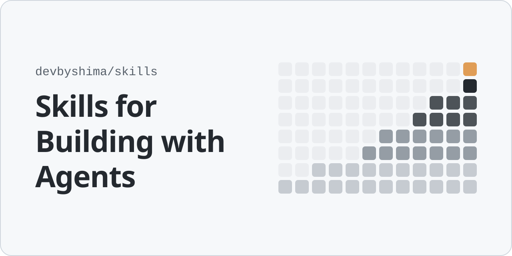

<picture>
  <source media="(prefers-color-scheme: dark)" srcset=".github/assets/banner-dark.svg">
  
</picture>

# Skills for Building with Agents

[](https://skills.sh/devbyshima/skills)

Agent skills I build and use, mostly for handing an agent work that takes hours or days.

An agent stops the moment the work looks done. These skills give it a way to know when the work is actually done, so it can keep going without me.

[Follow new skills](https://github.com/devbyshima/skills/releases)

## Install

```bash
npx skills@latest add devbyshima/skills
```

## Why use it?

Agents are trained on tasks a program can check. Give one a goal it can score and it will change something, run the check, read the score and go again, overnight if you let it. Give it a goal it can only eyeball and it stops early or drifts.

Most of the work is building that check, closing the ways to cheat it, and noticing when the run slows down. These skills do that part.

## Reference

- **[climb](./skills/agents/climb/SKILL.md)**: Turn a big goal into one `./verify` command and a `GOAL.md` an agent can run on for days.
- **[copycat](./skills/agents/copycat/SKILL.md)**: Port or rewrite a tool with the original as the oracle, then make it faster. `climb` uses it for ports.
- **[unblock](./skills/agents/unblock/SKILL.md)**: Run `/unblock` on a long run to find the one thing slowing it down.
- **[tasteful-icons](./skills/design/tasteful-icons/SKILL.md)**: App and integration icons in a frosted-glass squircle style, exported as SVG and PNG.

[PolyForm Noncommercial 1.0.0](LICENSE): free for non-commercial use.
